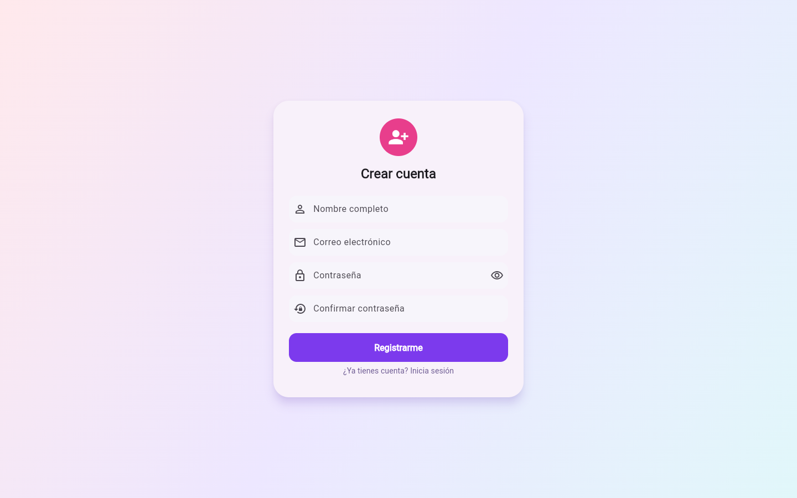

# Parcial Flutter + Firebase

Aplicación Flutter con autenticación y feed vertical de videos.

## Funcionalidades

- Registro con correo y contraseña.
- Inicio de sesión con correo y contraseña.
- Inicio de sesión con Google.
- Inicio de sesión con Facebook.
- Feed vertical con `PageView`.
- Reproducción automática del video visible.
- Videos locales incluidos en `assets/videos/`.
- Cierre de sesión en Firebase y proveedores sociales.
- Mensajes de error en español.

### Inicio de sesión

### Registro

## Evidencias

GitHub no permite reproducir MP4 directamente desde un README. Usa los enlaces
siguientes para abrir el reproductor de cada grabación:

- [Abrir evidencia 1](docs/videos/Parcial%20-%20Opera%202026-11-24%2000-38-51.mp4)
- [Abrir evidencia 2](docs/videos/Parcial%20-%20Opera%202026-11-24%2000-41-48.mp4)
- [Abrir evidencia 3](docs/videos/Parcial%20-%20Opera%202026-11-24%2000-42-34.mp4)
- [Abrir evidencia 4](docs/videos/Parcial%20-%20Opera%202026-11-24%2000-43-34.mp4)

