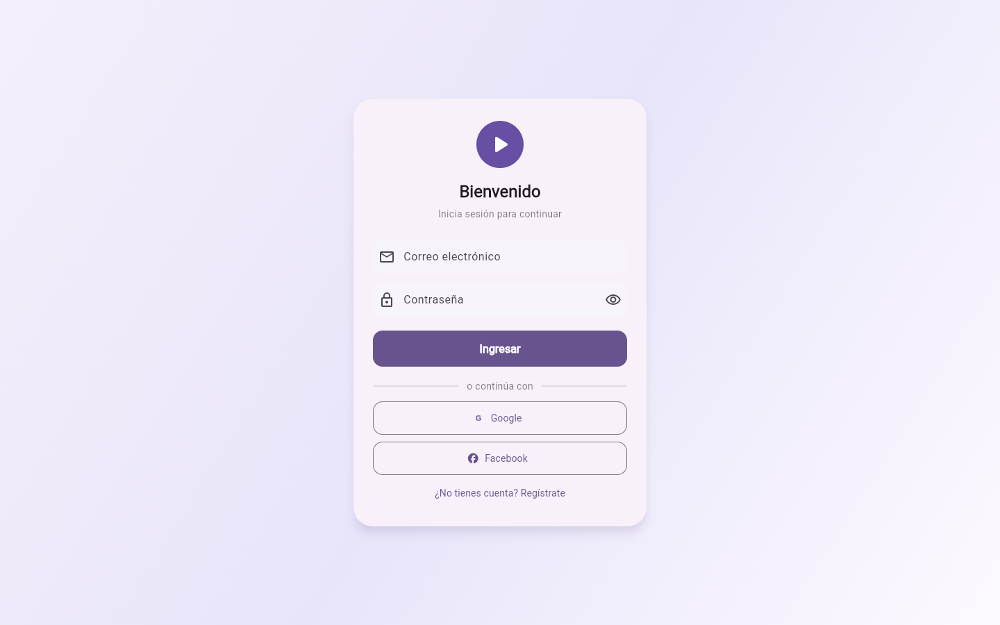

# Parcial Flutter + Firebase

Aplicación Flutter con autenticación y feed vertical de videos.

## Funcionalidades

- Registro con correo y contraseña.
- Inicio de sesión con correo y contraseña.
- Inicio de sesión con Google.
- Inicio de sesión con Facebook.
- Feed vertical con `PageView`.
- Reproducción automática del video visible.
- Videos locales incluidos en `assets/videos/`.
- Cierre de sesión en Firebase y proveedores sociales.
- Mensajes de error en español.

### Inicio de sesión

### Registro

## Evidencias

### Evidencia 1

<video src="./docs/videos/evidencia1.mp4" controls="controls" style="max-width: 100%;">
</video>

### Evidencia 2

<video src="./docs/videos/evidencia2.mp4" controls="controls" style="max-width: 100%;">
</video>

### Evidencia 3

<video src="./docs/videos/evidencia3.mp4" controls="controls" style="max-width: 100%;">
</video>

### Evidencia 4

<video src="./docs/videos/evidencia4.mp4" controls="controls" style="max-width: 100%;">
</video>

